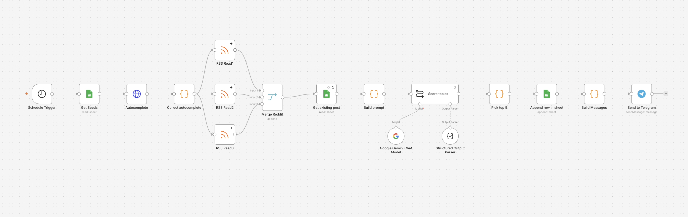

# n8n SEO Topic Scout (Autocomplete + Reddit + Gemini + Telegram + Google Sheets)

Two beginner-friendly n8n workflows that find blog topic ideas for an AI personal finance site. Every week the first workflow collects Google Autocomplete suggestions and trending Reddit questions, asks Google Gemini to score topic ideas, logs them in Google Sheets, and sends the top 5 to Telegram with Approve buttons. The second workflow marks a topic as approved in the sheet when you tap a button.

> Scores are AI estimates from public signals, not measured search volumes. Verify with a keyword tool before writing. Not financial advice.

## Flow

## Requirements

- n8n (Cloud or self-hosted)
- Google Gemini API key (free tier)
- Google account (Google Sheets)
- A Telegram bot from @BotFather (use a dedicated bot for this project)

## Setup

1. Create a Google Sheet with three tabs: `Seeds`, `Existing posts`, `Topic log`. Use the headers in `sample-data/`. Format columns A and B of `Topic log` as plain text.
2. Create a Telegram bot with @BotFather and press Start on it. Find your chat ID by sending a message to the bot while a Telegram Trigger is listening.
3. Import both files from `workflows/` into n8n.
4. Connect your Google Sheets, Gemini and Telegram credentials, select your own sheet in each Sheets node, and replace `YOUR_TELEGRAM_CHAT_ID` with your chat ID.
5. Run workflow 1 once manually, tap a button to test workflow 2, then activate both.

## Customize

- Edit the `Seeds` tab to match your niche (keep it to about 10 seeds).
- Edit the brand pillars and scoring rules in `prompts/scoring-prompt.md`, then paste them into the `Score topics` node.
- Change the schedule in the Schedule Trigger.

## What you will learn

HTTP Request with expressions, merging several sources, structured JSON output from an AI node, Google Sheets as a mini database, Telegram inline buttons and callback queries, restricting a bot to your own chat, and building a human approval step.

## Lessons learned

- Type callback data directly in n8n. Pasting it from a formatted table can drop the `|` characters.
- Make ids unique per run (date plus time). Duplicate ids make Update Row run several times.
- In an Update Row node, keep only the match column and the column you want to change. Extra empty columns overwrite your data with blanks.
- Use `Execute Once` and `Always Output Data` on a Sheets node that reads a list in the middle of a workflow.
- One Telegram bot can only send updates to one trigger, so use a dedicated bot per project.
- Taps on a button only reach n8n while the approvals workflow is Active.

## Notes

- Google Autocomplete is an unofficial endpoint. Keep seeds few and expect occasional rate limits.
- Reddit may block some cloud servers. The workflow continues without it if a feed fails.
- No tokens, sheet IDs, chat IDs or emails are stored in this repo.

## License

MIT, see [LICENSE](LICENSE).
